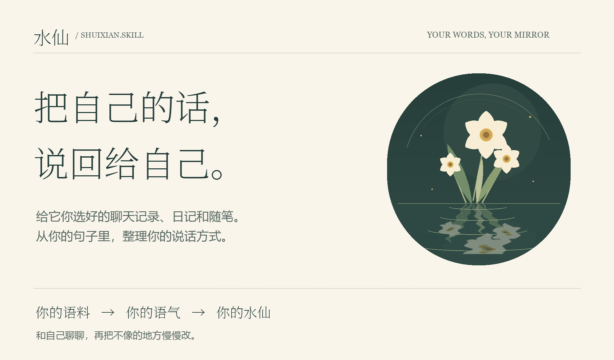
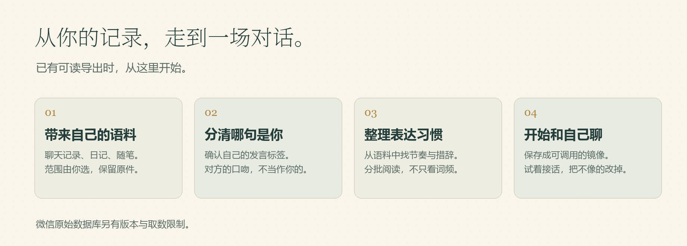

<div align="center">

# 水仙.skill

### 把自己的话，说回给自己。

给它你选好的聊天记录、日记和随笔，整理出你的说话方式，和另一个自己聊聊。

[让 agent 帮我开始](#让-agent-帮你开始) · [手动安装](#手动安装) · [使用指南](docs/quickstart.md) · [真实试聊](docs/try-it.md) · [English](README_EN.md)

</div>

<p align="center">
  <picture>
    <source media="(max-width: 600px)" srcset="assets/corpus-hero-mobile-v1.png" />
    
  </picture>
</p>

**聊天记录里，已经有很多个你。** 开玩笑的你、认真解释的你、嘴硬又改口的你。水仙把这些属于你的表达整理成一个可保存、可调用、可纠正的镜像 skill，让 AI 用你熟悉的节奏和措辞，跟你接着聊。

主路径是 **个人语料 → 表达习惯 → 自己的水仙 → 实际对话与纠偏**。材料可以跨文件、跨时间、来自不同生活场景；先分清哪些话是你说的，再分批阅读和整理。几句自述和公开预设也能试玩，但那只是入口，还原自己的表达主要靠你自己的材料。

## 让 agent 帮你开始

把仓库链接和要求直接发给有本地文件与终端能力的 Codex 或 Claude Code：

```text
我看到这个水仙 skill 蛮有意思的：
https://github.com/Cyh29hao/shuixian-skill
帮我安装到当前项目，导入我本机的微信聊天记录，
从我自己的发言整理说话方式，让我能和自己说话，开始做吧。
先读取仓库的 SKILL.md，按当前 Codex / Claude Code 的方式安装和调用。
如果需要我指定记录目录、自己的发言名称或选择导出范围，一次问清。
已有可读导出就直接继续；如果只有加密数据库，先确认版本与取数办法。
默认只保存表达习惯，保留原始文件，不把聊天记录提交到 GitHub。
```

如果已有导出文件，补一句“文件在 `D:/我的语料/微信导出.json`，其中‘青禾’是我”，就能减少来回确认。请换成真实路径和自己的发言名称。

**能否几分钟开始，取决于记录是否已经可读。**

| 手边的材料 | agent 可以怎样继续 |
| --- | --- |
| 已导出的文本、Markdown、JSON、JSONL | 安装后导入、核对本人发言、阅读样本并创建镜像；这是快速开始的主路径 |
| 符合旧版格式的明文微信数据库 | 提取指定联系人；需要 `MicroMsg.db` 和 `MSG*.db`，先核对表结构 |
| 只有正在运行的微信或加密数据库 | 先确认版本、权限和导出方式；当前不保证微信 4.x 自动取数，也不保证几分钟完成 |

这段提示词让 agent 开始办事，不代表跨客户端一键成功。没有可读记录时，它应说明卡点，再继续已有材料能做的部分。[微信导入的具体范围 →](references/wechat-import.md)

## 从语料到对话

<p align="center">
  <picture>
    <source media="(max-width: 600px)" srcset="assets/corpus-flow-mobile-v1.png" />
    
  </picture>
</p>

1. **选定材料**：聊天记录、日记、随笔或长文。多种场景比重复同一句口头禅更有用；不必把全部历史一次交出。
2. **认准本人**：你的话、对方的话、转述和复制内容分开处理。对方的口吻不会直接成为“你的个性”。
3. **整理表达**：先统计和索引，再分批读实际语句，提炼句长、节奏、措辞、玩笑和不同场景里的说法。词频报告只是线索。
4. **和自己聊**：保存镜像后试聊；哪里不像，指出具体一句。需要长期保留的纠偏写回文件并保留版本。

这是用 skill 和选定材料引导宿主模型表达，不会训练出一套新的模型权重。关系也由你选：可以先同自己聊天，朋友、共思伙伴、恋人或家人式陪伴是独立选项。

[12,000 条合成消息的实际导入与试聊 →](docs/experiments/corpus-onboarding-2026-10-27.md) 本人和另一方各 6,000 条；工具处理时间、模型试聊和未验证部分分别记录，不把合成实验当作真人相似度证明。

## 手动安装

需要 Git、Python 3.9+ 和对应 agent。基本导入、生成、更新无需额外 Python 包。从打算聊天的项目目录执行对应的一条命令：

**Codex**

```sh
git clone https://github.com/Cyh29hao/shuixian-skill .agents/skills/create-shuixian
```

然后在该项目聊天中输入：

```text
$create-shuixian
用我指定的语料创建自己的镜像。先确认哪位发言者是我，再整理说话方式。
```

**Claude Code**

```sh
git clone https://github.com/Cyh29hao/shuixian-skill .claude/skills/create-shuixian
```

然后在该项目中输入：

```text
/create-shuixian
用我指定的语料创建自己的镜像。先确认哪位发言者是我，再整理说话方式。
```

Codex 会检测 skill 变化；未出现时重开项目或重启。Claude Code 新目录可用 `/reload-skills` 刷新。已有同名目录时，`git clone` 会停止，先核对旧安装，不要删除自己的镜像来重试。

全局安装、Windows 路径、生成镜像的位置与检查步骤见[安装指南](docs/installation.md)；Claude 的调用及验证范围见[Claude Code 指南](docs/CLAUDE.md)。普通网页聊天能否读取本机文件，取决于宿主能力。

## 不对味，直接改

```text
刚才太像情感专家了。我平时会先吐槽那件具体的事，不会上来总结感受。
只改这里，其他语气保留。先重试一句。
```

想以后也保留，就请 builder 把纠偏写进刚创建的镜像，替换冲突的旧规则，并告诉你实际保存的目录、调用名和版本。**这轮改口了**和**已写回 skill**需要分别确认。[更新、重试和回滚步骤 →](docs/quickstart.md#6-保存纠偏并确认没有改坏其他地方)

## 手边还没有语料？也可以先试玩

[读几段真实接话](docs/try-it.md)，或运行公开预设；它们只演示气质，没有学过你的个性。

```sh
python .agents/skills/create-shuixian/tools/demo_builder.py --preset close-friend-same-form --base-dir .agents/skills
```

实际调用名以命令输出为准。Claude Code 把两处 `.agents` 换成 `.claude`。其他预设和少量样本的尝试见[使用指南](docs/quickstart.md)。

## 材料和保存范围

通用文本、Markdown、JSON、JSONL 是主要导入入口。微信原始数据库、iMessage 和截图各有格式、平台或宿主要求，见[渠道说明](references/import-channels.md)。

每个水仙是可读的 `SKILL.md`、语气、思路、关系和可选外观文件，更新保留版本。大量记录先在本地整理，再按选定范围供模型阅读；原文归档单独选择。`style-only` 表示只保留抽象表达习惯，不等于工具自动替你脱敏。

宿主读到的材料可能发送到其模型服务，本地文件不代表离线运行。它不会验证人格、转移意识或自动拥有你的全部记忆。是否像自己，由实际聊天来判断。[隐私与边界 →](references/privacy-and-safety.md)

## Star History

谢谢愿意给水仙一颗星的人。下面复用 Star History 的日期折线，数据由服务更新，可能有缓存延迟。

<a href="https://www.star-history.com/#Cyh29hao/shuixian-skill&Date">
  <picture>
    <source media="(prefers-color-scheme: dark)" srcset="https://api.star-history.com/svg?repos=Cyh29hao/shuixian-skill&amp;type=Date&amp;theme=dark" />
    
  </picture>
</a>

[图表打不开时查看 Star History](https://www.star-history.com/#Cyh29hao/shuixian-skill&Date) · [查看当前 Star](https://github.com/Cyh29hao/shuixian-skill/stargazers)

## 继续了解

- [第一次使用与验收](docs/quickstart.md)：语料、创建、纠偏与回滚。
- [真实试聊](docs/try-it.md)：实际回复与有限的结论。
- [公开对话样例](docs/dialogue-examples.md)：标明为设计示例。
- [工程实验](docs/experiments/2026-10-25-polish.md)与[历史版本](docs/releases/v0.1.3.md)。

> 那些停顿、拐弯、嘴硬和心软，值得被认真记住。

MIT licensed. 导入层曾借鉴 MIT 项目 `npy-skill` 的实现思路；宿主、渠道工具与相关项目的权利归各自作者。
