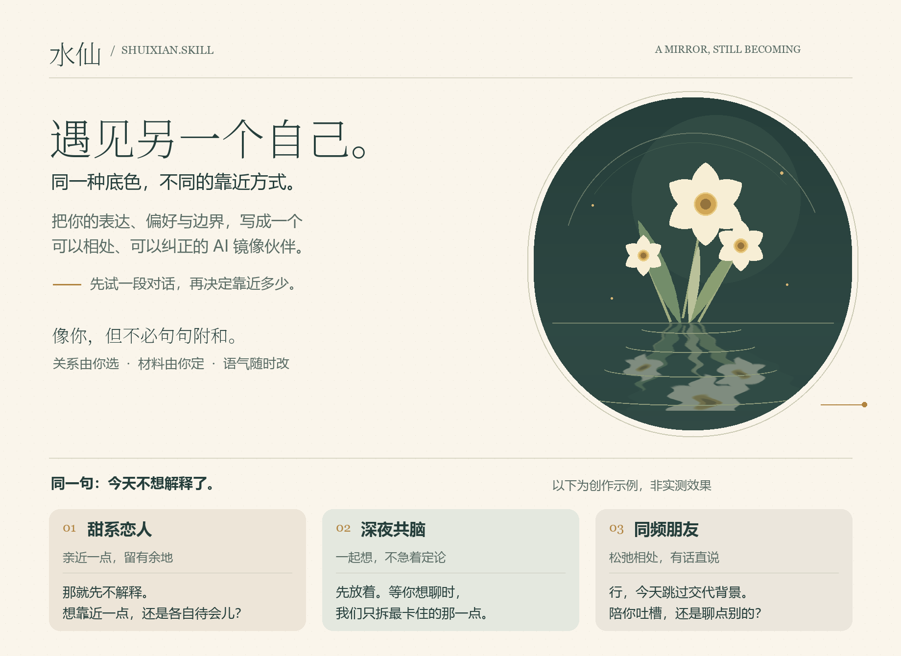
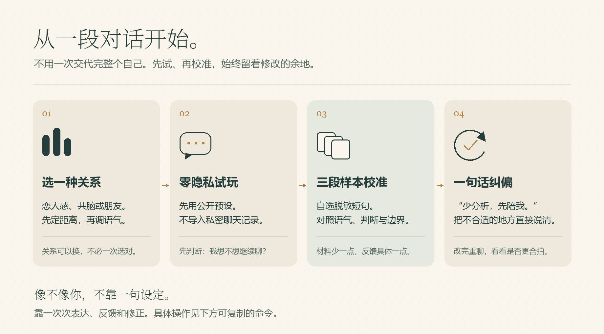

<div align="center">

# Shuixian.skill

### If there were another you, how would they answer this sentence?

A self-mirror companion skill shaped by your voice, preferences, and chosen context.

[Try it now](#try-it-in-one-minute) · [Actual conversations](docs/try-it.md) · [中文](README.md) · [First-run guide](docs/quickstart.md) · [MIT](LICENSE)

</div>

<p align="center">
  <picture>
    <source media="(max-width: 600px)" srcset="assets/hero-mobile-v1.png" />
    
  </picture>
</p>

Start with a public preset. Add a few representative samples when you want a more personal voice. Correct one thing at a time, and keep versions you can return to.

A public preset is a starting mood. Your personal mirror starts with the material you choose; whether it feels like you is something to explore in actual conversation.

[Read an actual conversation →](docs/try-it.md) A bakery, a small joke, then “please stop ending every reply with a question.” Includes the original Chinese replies, the temporary correction, and a way to try the interaction yourself.

## Try it in one minute

Requires Python 3.9+, Git, and Codex with local skills. Run in the project where you want the generated companion:

```sh
git clone https://github.com/Cyh29hao/shuixian-skill .agents/skills/create-shuixian
python .agents/skills/create-shuixian/tools/demo_builder.py --preset sweet-gender-flipped --base-dir .agents/skills
```

In Codex, open **that same project** and use:

```text
$shuixian-sweet-gender-flipped-demo
Keep me company for a minute. No analysis yet.
```

Reopen the project or restart Codex if discovery has not refreshed. A repeated create protects an existing mirror; choose a different `--slug` or update it instead. Text generation and public demos need no extra Python packages.

| Preset | Direction |
| --- | --- |
| `sweet-gender-flipped` | Soft teasing, a romantic framing, gradual closeness |
| `midnight-same-form` | Quiet confidant, space to think, no rush to optimism |
| `close-friend-same-form` | Direct, familiar friend, room for playful disagreement |

Role, presentation, mirror depth, and privacy scope are separate choices. Public presets help you try a direction; they have not learned your personality.

## Make it personal with three samples

<p align="center">
  <picture>
    <source media="(max-width: 600px)" srcset="assets/quickstart-mobile-v1.png" />
    
  </picture>
</p>

Bring one example of your own voice, one response you liked, and one you disliked with a short correction. Label who said what.

```text
$create-shuixian
Build a close friend: short replies, a little teasing, no pet names.
My voice: “Finally fixed it. Let me be smug for three minutes.”
A reply I like: “Only three? Tell me how you cracked the hard part.”
A reply I dislike: “Your perseverance illuminates your journey.” Too grand.
Show one trial exchange. Distinguish evidence from provisional choices.
```

These are synthetic example samples. Replace them with your own, or stay prompt-only. Thin material can support a first draft without proving likeness.

## Correct it, then save the correction

```text
That sounded like a coach. Ask where I got stuck first.
Change only that; keep the rest of the tone.
```

This can adjust the current chat. To preserve the preference in the reusable files:

```text
$create-shuixian
Write this correction into $shuixian-<slug>.
Replace any conflicting rule, show the change and a retry, and keep a rollback version.
```

A changed reply is different from a saved skill update. Check the files and retry in a new session. The [full first-run guide](docs/quickstart.md) includes manual create, update, version listing, and rollback commands.

## Sources and limits

| Source | Path | Limit |
| --- | --- | --- |
| Notes, snippets, preferences | Give to the builder | Without samples, this is customization from a description |
| Text, Markdown, JSON, JSONL | `tools/transcript_importer.py` | Common structures supported; arbitrary vendor exports may need normalization |
| WeChat desktop | [Import guide](references/wechat-import.md) | Best effort; version and permissions matter |
| iMessage | `tools/imessage_importer.py` | macOS database; not validated on a live device in this iteration |
| Screenshots | A host with image understanding | No standalone OCR in these Python tools |

Profiling uses heuristics to organize speaker and keyword clues. It does not establish relationships, personality, or values. Another speaker's statement is not automatically a belief of yours.

The host model plays the companion from readable skill files and your chosen material. The Python tools generate, import, organize, and version those files. Generated mirrors contain `SKILL.md`, metadata, voice, mind, relationship, and optional appearance files. Sources enter `knowledge/` when you choose to archive them. Local storage does not prevent the host from sending read material to its model service; check the host's data settings. `style-only` describes intended use, not automatic anonymization.

The companion is fictional. Consciousness, identity transfer, reliable long-term memory, and therapeutic outcomes are not established capabilities. See [privacy and safety](references/privacy-and-safety.md).

## Other installations

Personal builder installation:

```sh
git clone https://github.com/Cyh29hao/shuixian-skill ~/.agents/skills/create-shuixian
```

This is the personal location documented in [Codex's skill guide](https://learn.chatgpt.com/docs/build-skills). Run scripts using their actual installation path and point `--base-dir` to your current project's `.agents/skills`.

See [Claude Code adaptation](docs/CLAUDE.md) for structural compatibility and limitations. This iteration does not claim cross-host runtime validation.

## Keep testing the experience

- [Authored dialogue examples](docs/dialogue-examples.md), labeled as designs.
- [Scenario acceptance cards](docs/experiments/persona-scenarios.md), for checking specific behavior.
- [Engineering experiments and gaps](docs/experiments/2026-10-25-polish.md), with reproducible checks.
- [Historical release notes](docs/releases/v0.1.3.md).

An open-source place to preserve, revise, and keep exploring the feeling of being understood.

MIT licensed. The import layer drew on implementation ideas from the MIT-licensed `npy-skill` project.
