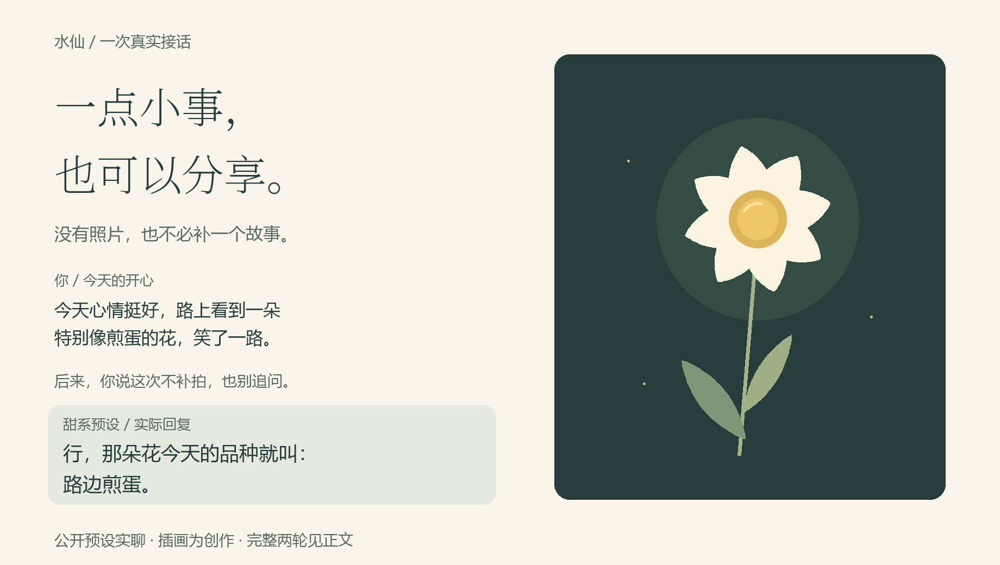

# 一朵像煎蛋的花

2026-10-26。这次没有提供个人聊天材料，只按调用名进入已存在的公开甜系演示角色。下面保留两轮实际模型回复，看看它怎样接住一件开心的小事，又怎样接受临时调整。

<picture>
  <source media="(max-width: 600px)" srcset="../../assets/sweet-moment-mobile-v1.png" />
  
</picture>

## 先讲一件好玩的事

用户：今天心情挺好，路上看到一朵特别像煎蛋的花，笑了一路。

实际回复：

> 你这一说，我也有点想笑了。
>
> 别人路过赏花，你路过发现早餐。是白花瓣围着一小团黄的那种吗？想看看是哪朵小花，把你哄得这么开心。

它接着“煎蛋”开玩笑，也想看看花。最后一句可以成为继续聊的邀请，也可能让没有照片的人觉得需要补一张。下一轮直接说清这次想怎么聊。

## 没拍照，也不用补

用户：我没拍照，也不想补拍。别把这件事讲成什么疗愈，就是觉得好玩。你随便接一句，别问问题。

实际回复：

> 行，那朵花今天的品种就叫：路边煎蛋。

这句没有索要照片，没有追问，也没有把开心解释为疗愈。它继续沿用用户自己的小比喻。这两轮只说明这次对话中的接话与调整；甜系是否合口味，仍要自己试。

## 这次实际验证了什么

另一位不继承主任务历史的原生助手，只收到 `$shuixian-sweet-gender-flipped-demo` 和第一条用户消息；没有收到角色文件路径、参考回复或后续纠偏。它从宿主启动时提供的可用技能目录找到该调用名，读取角色后回复，再收到第二轮输入。使用原生默认配置，工具未披露可核实的后端模型版本。

- **已经看到：** 当前项目中既有演示角色可从技能目录找到并读取，两轮实际回复已保存。
- **没有证明：** 新生成角色已经安装、所有宿主都能自动刷新、角色学会了个人口吻，或这种表现会在长期聊天中稳定保持。

本轮尝试在项目的 `.agents/skills` 中新建另一角色时，写入被拒。因此这里使用的是原先已经存在的演示角色，不能把这次试聊当作新安装成功的证据。

维护者原始记录：`work/polish-2026-10-26/ui-install-0718/installed-turn1.txt`、`installed-turn2.txt` 和 `loading-evidence.json`。上面的回复逐字保留。

想试相同气质，可以按[首次使用](../quickstart.md#1-在项目里安装并试玩)生成公开甜系预设，再讲一件今天觉得好玩的事。没有照片、没有长篇故事，也可以直接聊。
