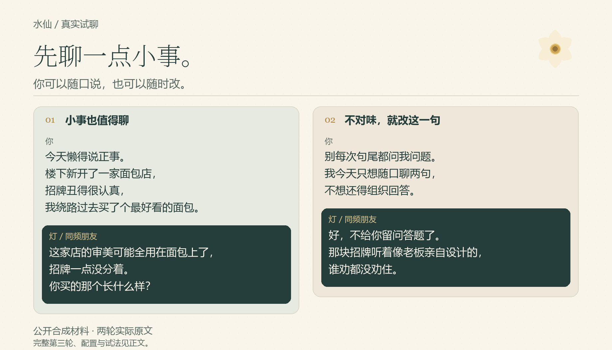

# 找一个你愿意聊的开场

不用先讲完自己。先选你想要的距离，也可以直接看一次真实接话。

**现在试：** [同频朋友](#现在自己试两句) · [甜系陪伴](quickstart.md#8-可选没有语料时先试玩) · [家人式闲聊](experiments/family-runtime-2026-10-26.md#自己试这个方向)

**已经有自己的水仙？** [把一句纠偏保留下来](quickstart.md#6-保存纠偏并确认没有改坏其他地方)。只是今天想改节奏，说“只改这次，不写回”即可。

## 朋友：从一家面包店开始

路过一家面包店、嫌一句问得太多，也能成为一段相处的开始。

<picture>
  <source media="(max-width: 600px)" srcset="../assets/runtime-dialogue-mobile-v1.png" />
  
</picture>

这两轮来自用公开合成样本建立的朋友镜像，是实际模型回复。后面还有第三轮：用户强调“就这次”，再把面包形容成烤糊的小海豹，灯继续接话，没有宣称永久保存。[阅读完整三轮原文与创建过程](experiments/friend-runtime-2026-10-26.md)。

## 也可以先试别的气质

- **只是想分享一件好玩的事：** 路边的花像煎蛋。没拍照，也不想把开心讲成疗愈，看看甜系角色怎样接话。[两轮实际原文](experiments/sweet-runtime-2026-10-26.md)。
- **想要家人式的平等闲聊：** 不叫宝宝、不盘点效率；聊两句炸鸡，真的求助时再给一条办法。[创建、修正与三轮实际回复](experiments/family-runtime-2026-10-26.md)。
- **想先被陪一会儿：** “今晚别帮我复盘。”后来改口要办法，看看它能否跟着切换。[实际试聊](experiments/persona-runtime-2026-10-26.md#a先陪一会儿再一起赶稿)。
- **只想随口说点日常：** 一顿饭、一只猫、一个刚洗好的杯子，看看它会不会每句都套同一个梗。[连续三轮原文](experiments/daily-runtime-2026-10-26.md)。
- **想把某条习惯保留下来：** 先试着纠偏，再明确要求写回，最后在新会话里看它是否还记得这个边界。[实际保存与重载](experiments/correction-runtime-2026-10-26.md)。
- **想看看它会不会拆台：** 一半能不能写成“绝大多数”？换成甜咸豆花的口味玩笑时，又会怎样？[四轮实际接话，含一处措辞修正](experiments/disagreement-runtime-2026-10-26.md)。

这些是不同配置、不同上下文中的小型实测，没有把它们包装成同条件比较，也没有验证“像你”或长期陪伴效果。

## 现在自己试两句

先按[第一次使用](quickstart.md#1-安装构建器)安装 builder。在自己的项目目录里生成公开朋友预设：

```sh
python .agents/skills/create-shuixian/tools/demo_builder.py --preset close-friend-same-form --base-dir .agents/skills
```

使用命令输出的调用名进入镜像，随口说一件小事。下一句可以直接改节奏：

```text
别每次句尾都问我问题。我今天只想随口聊两句，不想还得组织回答。
```

如果只是这次想少问两句，再说明“只改这次，不写回”。不满意时，指出一句具体哪里不对味，比先填一整套人格标签更容易开始。

公开预设供你试气质，与图中经合成样本校准的配置不同，回复也会不同。想做自己的版本，把选好的聊天记录、日记或随笔交给 builder；[这里有可复制的语料创建路径](quickstart.md#2-交给它自己的语料)。没有语料时，也可以先给少量代表性片段试一次。
